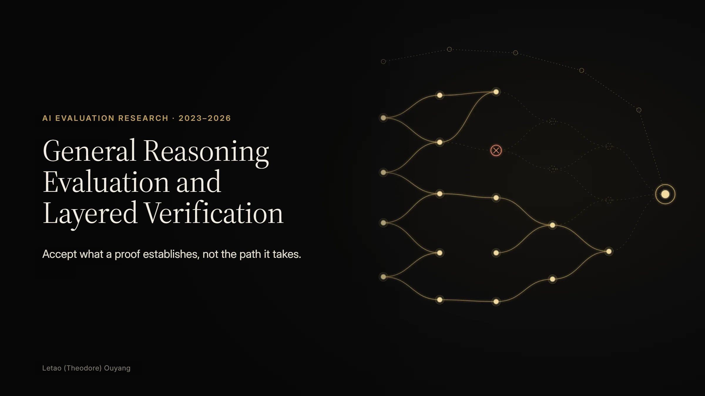
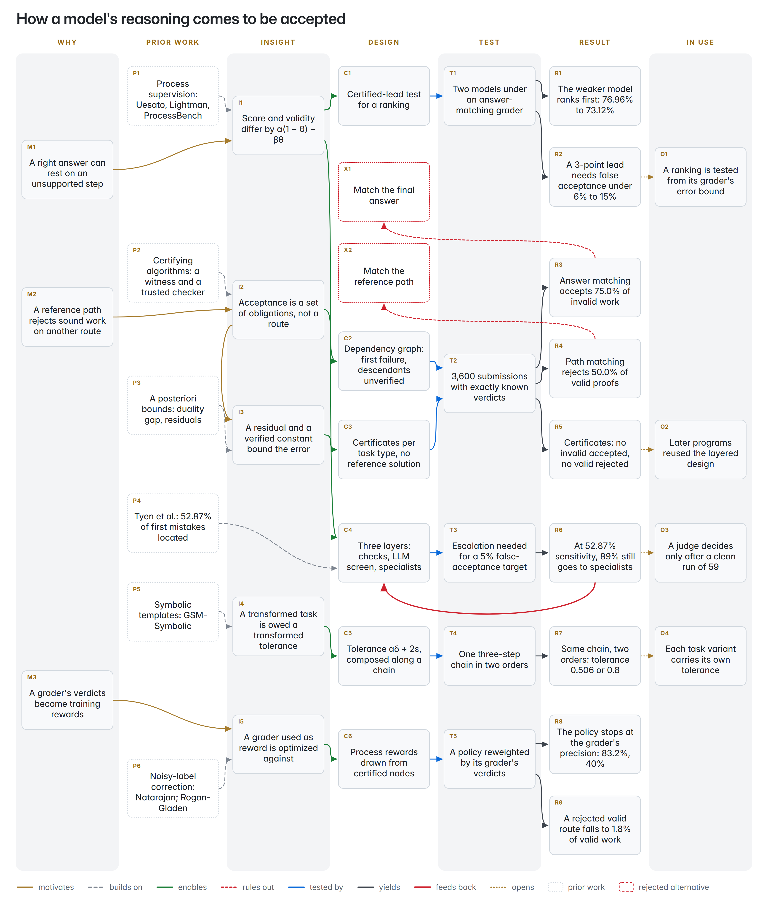

<p align="center"></p>

# General Reasoning Evaluation and Layered Verification

**Letao (Theodore) Ouyang** · Researcher · Duke University × Frontier AI Research Laboratory · September 2023 – September 2026

[Article](manuscript/general-reasoning-evaluation-and-layered-verification.md) · [PDF](paper/paper.pdf) · [Results](reproduce/results.md) · [Derivations](docs/derivations.md) · [Design notes](docs/design-notes.md) · [Research route](docs/research-route.md) · [Literature](docs/literature.md)

**What should entitle a model's reasoning to be accepted?**

A model can reach the right answer through an unsupported step, and a grader that matches a reference solution
rejects a correct proof that takes another route. I designed an acceptance rule that resolves both: a conclusion
stands when its assumptions, derivations and execution evidence support it, whichever valid route was taken, and a
failed step removes support from everything downstream. Checkable obligations are discharged by certificates that
need no reference solution, LLM-assisted screening flags possible gaps, and specialists adjudicate what remains. I
also derived what a grader must achieve before its verdicts can be used. A policy trained against a grader
converges to that grader's positive predictive value, which on a test set of 3,600 submissions with known verdicts
is **40%** for final-answer matching and **100%** for certificate checking.

## Three results to start with

| Result | Why it matters | Where |
| --- | --- | --- |
| On 3,600 submissions with exactly known verdicts, final-answer matching accepts **75.0%** of the invalid ones and reference-path matching rejects **50.0%** of the valid ones. Certificate verification makes neither error | Strict error detection and acceptance of valid alternative routes hold together, with no reference solution in the trusted base | [§3, §6](manuscript/general-reasoning-evaluation-and-layered-verification.md) · [D5](docs/derivations.md#d5-the-projected-residual-certificate) |
| A policy trained against a grader stops at the grader's positive predictive value: **83.2%** true validity while the observed score reads 100% | False acceptance sets a ceiling on what training can reach, and false rejection removes valid routes: a route the grader rejects falls to 1.8% of valid work | [§5](manuscript/general-reasoning-evaluation-and-layered-verification.md) · [D9](docs/derivations.md#d9-what-a-policy-learns-from-a-grader) |
| A leaderboard lead of $`g`$ over a rival scoring $`s`$ is certified exactly when the grader's false acceptance is below $`g/(1-s)`$: **15%** for three points over a rival at 80%, 6% over a rival at 50% | A test that applies to any published ranking whose grader has a measured error rate | [§1](manuscript/general-reasoning-evaluation-and-layered-verification.md) · [D2](docs/derivations.md#d2-when-a-lead-is-certified) |

All 68 figures in the article are recomputed in [results](reproduce/results.md).

## The problem

Checking the final answer is enough only when the answer is the entire deliverable. Among solutions with correct
final answers, the share that still contains a process error rises with difficulty, from 3.5% on GSM8K to 51.8% on
Omni-MATH (ProcessBench). With false acceptance $`\alpha`$ and false rejection $`\beta`$, a model's score and its
true validity rate $`\theta`$ are related by

```math
s = \alpha + (1 - \alpha - \beta)\,\theta, \qquad s - \theta = \alpha(1-\theta) - \beta\theta ,
```

and more problems do not close the gap. Two models with true validity of 72% and 64% score 73.12% and 76.96% under
answer matching, so the weaker one ranks first. The same errors pass into training once the grader's verdicts are
used as rewards.

## The idea

**Acceptance by proof obligations.** A task specification fixes the domain assumptions, the permitted execution
environment, the target conclusion and the obligations that establish it. A submission's claims form a dependency
graph; a valid alternative derivation passes on the same terms as the reference route, and the first failed node
marks its descendants unverified.

**Certificates that need no reference solution.** To bound how far a candidate is from the truth, a residual the
candidate exposes and a constant the task designer has verified are enough. For an equality-constrained quadratic
program:

```math
0 \le f(x) - v^* \le \frac{\|P_{\ker\,A}\, r\|_2^2}{2\mu}, \qquad r = Hx + c + A^\top\nu .
```

| Task type | Residual the submission exposes | Constant the designer verifies | Certificate |
| --- | --- | --- | --- |
| Equality-constrained quadratic program | $`P_{\ker\,A} r`$ | $`\mu = \lambda_{\min}(Z^\top H Z)`$ | $`f(x) - v^* \le \lVert P_{\ker\,A} r\rVert _2^2 / (2\mu)`$ |
| Convex program | A primal-feasible $`x`$ and a dual-feasible $`(\lambda, \nu)`$ | None | $`f(x) - v^* \le f(x) - g(\lambda, \nu)`$ |
| Linear system $`Ax = b`$ | $`b - Ax`$ | A lower bound on $`\sigma_{\min}(A)`$ | $`\lVert x - x^*\rVert _2 \le \lVert b - Ax\rVert _2 / \sigma_{\min}(A)`$ |
| Eigenpair of a symmetric matrix | $`A\hat{v} - \hat{\lambda}\hat{v}`$ | None | $`\min_i \left\lvert \lambda_i - \hat{\lambda}\right\rvert  \le \lVert A\hat{v} - \hat{\lambda}\hat{v}\rVert _2 / \lVert \hat{v}\rVert _2`$ |
| Fixed point of a contraction $`g`$ | $`g(x) - x`$ | A Lipschitz constant $`L < 1`$ | $`\lVert x - x^*\rVert  \le \lVert g(x) - x\rVert  / (1 - L)`$ |

**Three layers, with a rule for the boundary.** Code and certificates decide what can be computed. An LLM judge
screens for missing evidence, misapplied rules and gaps. Specialists adjudicate what remains. With screening
sensitivity se, a share $`1 - \alpha^*/(1-\text{se})`$ of unflagged work still has to reach specialists to hold the
system's false acceptance at $`\alpha^*`$, so a judge screens until its measured sensitivity clears
$`1 - \alpha^*`$ and decides after.

## Results

**A test set with exactly known verdicts.** 600 strongly convex quadratic task families in exact rational
arithmetic, six submissions each: two valid routes (Lagrange multipliers and equality elimination) and four
controlled defects, three of which report the correct optimal value.

| Acceptance protocol | False acceptance on 2,400 invalid submissions | False rejection on 1,200 valid proofs | Valid share of accepted submissions |
| --- | ---: | ---: | ---: |
| Final-answer matching | 75.0% | 0.0% | 40.0% |
| Strict reference-path matching | 0.0% | 50.0% | 100.0% |
| **Certificate verification** | **0.0%** | **0.0%** | **100.0%** |

**What a policy learns from a grader.** For a model at 64% true validity under answer matching with 36% false
acceptance:

| Optimization strength $`\eta`$ | 0 | 1 | 2 | 4 | Limit |
| --- | ---: | ---: | ---: | ---: | ---: |
| Observed score | 77.0% | 90.1% | 96.1% | 99.5% | 100% |
| True validity | 64.0% | 74.9% | 79.9% | 82.7% | 83.2% |

The last column of the first table is the same ceiling. A policy trained against final-answer matching on that mix
moves from one third valid work to 40% and stops. Trained against the reference path it reaches 100% and loses the
elimination route. Trained against certificate checking it reaches 100% with both routes intact.

**When a screen may decide.** At a sensitivity of 52.87%, the best measured for locating a first mistake, and a
target of 5%, 89% of unflagged work still has to reach a specialist; 75% at 0.80 and 50% at 0.90. A checker earns
decisive standing by a clean run: 59 known-invalid items rejected without exception bound its false acceptance at
5% with 95% confidence, and 299 bound it at 1%.

**Task transformations.** A $`\delta`$-optimal solution is owed $`a\delta + 2\varepsilon`$ after a verified
transformation. The same three steps in two orders owe 0.506 and 0.8.

**Economics.** For a certificate family whose engineering costs as much as 400 expert reviews, the break-even is
482 submissions, and every further submission releases 83% of an expert review.

## What is new

The individual certificates are standard results of optimization and numerical analysis, and certifying algorithms
are an established discipline. What I built:

1. **An acceptance rule for model reasoning that does not name a route.** Proof obligations over a dependency
   graph, with a failed node removing support from its descendants. Process supervision labels steps one by one;
   the graph says what a failed step does to the rest.
2. **A catalogue of certificates as the grading layer.** One template across task types, with the reference
   solution removed from the trusted base.
3. **The condition under which a ranking is certified.** $`\bar\alpha < g/(1-s_B)`$, tight, from the grader's
   error bound alone.
4. **The limit of training against a grader.** The policy converges to the grader's positive predictive value.
   Reward overoptimization has been charted empirically; this is its closed form for a binary grader, with the
   two errors priced separately.
5. **The threshold at which a judge may decide.** The escalation rate $`\rho \ge 1 - \alpha^*/(1-\text{se})`$ and
   the clean-run sample sizes that grant decisive standing.
6. **The composition law for task transformations.** $`a = \prod_j a_j`$ and
   $`\varepsilon = \sum_j (\prod_{l>j} a_l)\,\varepsilon_j`$: the order of a chain is part of its specification.

[Where this work sits](docs/literature.md) sets each of these against the closest prior work, and the
[bibliography](docs/bibliography.md) lists all 186 sources.

## How the argument was built

<picture>
  <source media="(prefers-color-scheme: dark)" srcset="assets/route-dark.png">
  
</picture>

The route is a network. The acceptance rule, the certificates and the thresholds were worked out against each
other, and three results went back and changed the design.

- **Acceptance without a reference route.** The test set ruled out both baselines: answer matching for what it
  accepts, path matching for what it rejects.
- **When a judge may decide.** At the measured sensitivity of the best model a screen saves almost no expert time.
  That result fixed the judge's standing as a screen and made the escalated sample its calibration.
- **Graders as rewards.** The ceiling and the lost routes are the reason process rewards are drawn from certified
  nodes.

The [research route](docs/research-route.md) explains all 40 steps and all 38 links.

## In production

- The team produced roughly 500 scientific reasoning tasks a week. Each task included a detailed, step-by-step
  reference solution and repeated verification of the argument.
- I evaluated answers, visible reasoning and execution evidence together: I cross-checked displayed reasoning
  against tool calls, return values and intermediate outputs, and recorded correctness, compliance and efficiency
  as separate results.
- Later programs reused the layered design.

## If you grade model reasoning

| If you | The article shows | Do this |
| --- | --- | --- |
| Score by final answer | False acceptance credits invalid work and can reverse a ranking | Measure the grader's false acceptance and apply the certified-lead test before reading a small lead |
| Match against a reference solution | Valid alternative routes are rejected, and training removes them from the policy | State obligations, not a path, and withhold the reference from the screening layer |
| Let an LLM judge decide | At a sensitivity near one half the screen saves almost nothing at a 5% target | Escalate unflagged work at random, measure sensitivity on that sample, and promote the judge after a clean run |
| Train on grader verdicts | The policy converges to the grader's positive predictive value | Draw process rewards from certified nodes where a certificate exists |

## Repository

| Path | Contents |
| --- | --- |
| [`manuscript/`](manuscript/general-reasoning-evaluation-and-layered-verification.md) | The article |
| [`paper/paper.pdf`](paper/paper.pdf) | The article as a PDF |
| [`docs/derivations.md`](docs/derivations.md) | Every proof in full, D1 to D11 |
| [`docs/design-notes.md`](docs/design-notes.md) | Each design choice, the alternative it beat, and which layer decides what |
| [`docs/research-route.md`](docs/research-route.md) | The logic of the work as a network, node by node |
| [`docs/literature.md`](docs/literature.md) · [`docs/bibliography.md`](docs/bibliography.md) | Where the work sits, and the 186 sources |
| [`reproduce/`](reproduce/README.md) | Code that rebuilds the test set and recomputes every figure in the article, and the [results](reproduce/results.md) |

## Disclosure

I conducted this project through a Duke University collaboration with a frontier AI research laboratory. The
partner's name and proprietary system identifiers are withheld under a nondisclosure agreement. The project title,
my role, locations, dates, system architecture and mathematical formulations are cleared for public disclosure.
Production records and operating figures are withheld; the measurements are taken on a test set whose verdicts are
known exactly.

## Citation

Letao (Theodore) Ouyang, *General Reasoning Evaluation and Layered Verification* (Duke University, 2026),
<https://www.theodoreoy.com/experience/general-reasoning-evaluation-and-layered-verification/>. See
[CITATION.cff](CITATION.cff).

[theodore.oy2025@gmail.com](mailto:theodore.oy2025@gmail.com) · [10@alumni.duke.edu](mailto:10@alumni.duke.edu)

© Letao (Theodore) Ouyang. All rights reserved.
