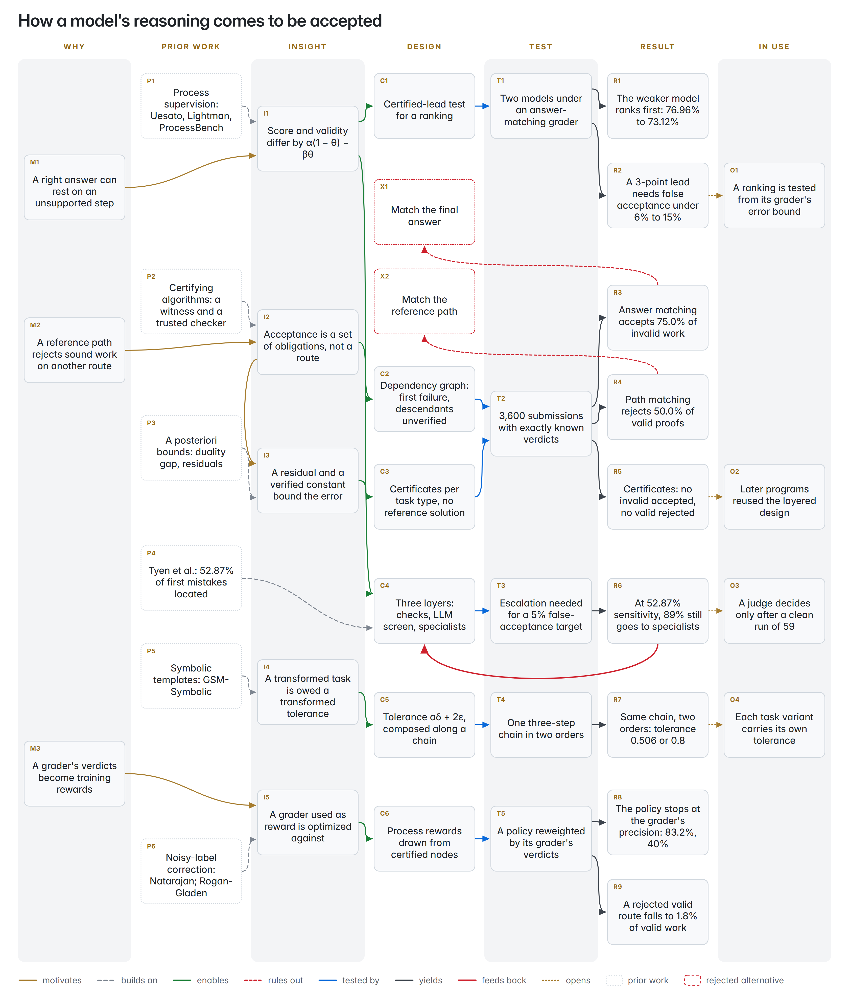

# Research route

How the argument was built: which observation forced which design choice, where a result went back and changed the
design, and what the design became in operation. The work did not run from problem to solution in one line. The
acceptance rule, the certificates and the thresholds were worked out against each other, because a rule is only
usable when something can check it and something says how good that checker has to be.

<picture>
  <source media="(prefers-color-scheme: dark)" srcset="../assets/route-dark.png">
  
</picture>

## Reading the figure

Columns are kinds of step, not stages in time. A link can run between any two columns, and three run backwards,
from a result to the design.

| Link | Meaning |
| --- | --- |
| motivates | A need or an insight that made the next step necessary |
| builds on | A published result the step starts from |
| enables | A step that makes another one possible |
| tested by / yields | A design and the test that checks it; a test and what it produced |
| feeds back | A result that changed the design |
| rules out | A finding that excludes an alternative |
| opens | A design or result that became an operating standard |

Solid boxes are my own steps. Dotted boxes are prior work, and red dashed boxes are alternatives I rejected. Design
boxes are numbered C1 to C6 so that they are not confused with the derivations D1 to D11.

## The five threads

### 1. What a score says about validity

M1 → I1 → C1 → T1 → R1, R2.

A correct answer can rest on an unsupported step (M1), and the share of correct-answer solutions with a process
error rises with difficulty (P1). In terms of a grader's two error rates the score and the true validity rate
differ by $`\alpha(1-\theta) - \beta\theta`$ (I1, [D1](derivations.md#d1-grading-error-moves-scores-and-can-reverse-rankings)).
Two models at 72% and 64% validity score 73.12% and 76.96% under answer matching, so the weaker one ranks first
(T1, R1). Read in the other direction the same equation gives a test (C1): a lead of $`g`$ over a rival scoring
$`s`$ certifies the order of true validity exactly when the grader's false acceptance is below $`g/(1-s)`$
([D2](derivations.md#d2-when-a-lead-is-certified)). A three-point lead needs a grader below 15% against a rival at
80% and below 6% against a rival at 50% (R2).

### 2. Acceptance without a reference route

M2 → I2 → C2, and I2 → I3 → C3; both → T2 → R3, R4, R5, with R3 and R4 ruling out X1 and X2.

A reference path rejects sound work that takes another route (M2). I defined acceptance by proof obligations (I2):
a conclusion stands when its assumptions, derivations and execution evidence support it, whichever route was taken.
The obligations form a dependency graph (C2), and a failed node removes support from its descendants
([D3](derivations.md#d3-proof-obligations-soundness-and-failure-propagation)). This is the discipline of certifying
algorithms (P2) carried to model output.

Some obligations can be discharged by computation (I3). A residual the submission exposes and a constant the task
designer has verified bound the distance to the truth, and the true solution never enters. One template covers
convex programs, linear systems, eigenpairs and fixed points (C3,
[D5](derivations.md#d5-the-projected-residual-certificate),
[D6](derivations.md#d6-the-certificate-template-for-other-task-types)).

The test set (T2) has 3,600 submissions whose verdicts are known exactly: two ways of being right, three ways of
being wrong with the right answer, and one way of being wrong with the wrong answer. Final-answer matching accepted
75.0% of the invalid submissions (R3), which rules it out (X1). Reference-path matching rejected 50.0% of the valid
proofs (R4), which rules it out (X2). Certificate verification made neither error (R5).

### 3. When a judge may decide

I1 → C4 → T3 → R6 → C4.

The same two error rates set the boundary between the layers (C4). With a screen of sensitivity se and random
escalation of unflagged work at rate $`\rho`$, the system's false acceptance is $`(1-\text{se})(1-\rho)`$
([D4](derivations.md#d4-when-a-screen-may-decide)). At the sensitivity measured for the best model on locating a
first mistake, 52.87% (P4), holding false acceptance at 5% sends 89% of unflagged work to a specialist (T3, R6).
That result went back into the design (R6 → C4): the LLM judge screens and does not decide, the escalated share
doubles as its calibration sample, and it earns decisive standing by a clean run.

### 4. Variants that keep their meaning

P5 → I4 → C5 → T4 → R7.

Templates fix variable domains and answer formulas (P5). A transformed task is also owed a transformed tolerance
(I4): after a verified bijection with scaling $`a`$ and error $`\varepsilon`$, a $`\delta`$-optimal solution is owed
$`a\delta + 2\varepsilon`$, and a chain of transformations composes by a stated law (C5,
[D7](derivations.md#d7-transformations-propagate-tolerances)). The same three steps in two orders owe 0.506 and
0.8 (T4, R7).

### 5. Graders as rewards

M3 → I5 → C6 → T5 → R8, R9.

A grader's verdicts become training rewards (M3). Noisy-label theory corrects a score for a grader that is only
observed (P6). A grader used as a reward is optimized against (I5), and a policy reweighted by its verdicts
converges to the grader's positive predictive value while its observed score goes to 100% (T5, R8,
[D9](derivations.md#d9-what-a-policy-learns-from-a-grader)): 83.2% for the weaker model of thread 1, and 40% on the
test set of thread 2 under answer matching. False rejection has a different cost: a valid route the grader always
rejects falls from half of valid work to 1.8% (R9). Certificate checking has neither cost on the families it
decides, which is the reason process rewards are drawn from certified nodes (C6).

## From design to operation

| Standard | Comes from | What it does |
| --- | --- | --- |
| O1 A ranking tested from its grader's error bound | R2 | The certified-lead condition applies to any published ranking whose grader has a measured error rate |
| O2 The layered design | R5 | Roughly 500 scientific reasoning tasks a week were produced under it, and later programs reused it |
| O3 A clean run before a judge decides | R6 | 59 known-invalid items rejected without exception bound false acceptance at 5% with 95% confidence; 299 bound it at 1% |
| O4 A tolerance per variant | R7 | Each transformed task carries the tolerance its chain of transformations owes |

## Every node

| Node | Column | What it is |
| --- | --- | --- |
| **M1** A right answer can rest on an unsupported step | Why | A correct answer can coexist with unsupported assumptions, misapplied rules or tool use that violates the task specification. |
| **M2** A reference path rejects sound work on another route | Why | A grader that matches a reference solution rejects a correct proof that takes a different route. |
| **M3** A grader's verdicts become training rewards | Why | Step-level labels and acceptance verdicts pass into process reward models and RLHF policies, so the grader's errors pass with them. |
| **P1** Process supervision: Uesato, Lightman, ProcessBench | Prior Work | Correct answers conceal process errors, in 3.5% to 51.8% of correct-answer solutions as difficulty rises (ProcessBench). |
| **P2** Certifying algorithms: a witness and a trusted checker | Prior Work | McConnell et al. (2011): the producer is not trusted; it hands over a witness that a simple checker validates. |
| **P3** A posteriori bounds: duality gap, residuals | Prior Work | Boyd and Vandenberghe (2004) and the classical residual bounds of numerical analysis. |
| **P4** Tyen et al.: 52.87% of first mistakes located | Prior Work | The best model tested located the first mistake in 52.87% of reasoning traces. |
| **P5** Symbolic templates: GSM-Symbolic | Prior Work | Templates parameterize variable domains and answer formulas (Mirzadeh et al. 2024). |
| **P6** Noisy-label correction: Natarajan; Rogan-Gladen | Prior Work | Unbiased correction of a score for known false-acceptance and false-rejection rates. |
| **I1** Score and validity differ by α(1 − θ) − βθ | Insight | False acceptance credits invalid work and false rejection penalizes valid work; more items do not close the gap (D1). |
| **I2** Acceptance is a set of obligations, not a route | Insight | A conclusion stands when its assumptions, derivations and execution evidence support it, whichever valid route was taken (D3). |
| **I3** A residual and a verified constant bound the error | Insight | To bound how far a candidate is from the truth, a residual the candidate exposes and a stability constant of the problem are enough. The true solution never enters (D5, D6). |
| **I4** A transformed task is owed a transformed tolerance | Insight | A unit conversion, rescaling or discretization changes what counts as an acceptable solution (D7). |
| **I5** A grader used as reward is optimized against | Insight | Once the verdict is the reward, the policy moves toward whatever the grader accepts (D9). |
| **C1** Certified-lead test for a ranking | Design | A lead of g over a rival scoring s certifies the order of true validity exactly when the grader's false acceptance is below g/(1 − s) (D2). |
| **X1** Match the final answer | Design | Rejected: it accepts invalid work that reports the right answer. |
| **X2** Match the reference path | Design | Rejected: it rejects valid proofs that take another route. |
| **C2** Dependency graph: first failure, descendants unverified | Design | Each conclusion is linked to its assumptions, method applicability, evidence and execution; a failed node removes support from everything downstream. |
| **C3** Certificates per task type, no reference solution | Design | Convex programs, linear systems, eigenpairs and fixed points each have a residual, a verified constant and an inequality between them. |
| **C4** Three layers: checks, LLM screen, specialists | Design | Code and certificates decide what can be computed, an LLM flags possible gaps, and specialists adjudicate what remains. Unflagged work is escalated at random at rate ρ (D4). |
| **C5** Tolerance aδ + 2ε, composed along a chain | Design | The tolerance owed after a verified transformation, and the law for a chain of transformations. |
| **C6** Process rewards drawn from certified nodes | Design | On the families a certificate decides, the reward has no false acceptance and no false rejection. |
| **T1** Two models under an answer-matching grader | Test | True validity 72% and 64%, false acceptance 4% and 36%. |
| **T2** 3,600 submissions with exactly known verdicts | Test | 600 strongly convex quadratic task families in exact rational arithmetic: two valid routes and four controlled defects per family. |
| **T3** Escalation needed for a 5% false-acceptance target | Test | The share of unflagged work that must reach a specialist, as a function of the screen's sensitivity. |
| **T4** One three-step chain in two orders | Test | An exact conversion, an exact rescaling and a discretization with error 0.003, applied to a solution that is 0.01 optimal. |
| **T5** A policy reweighted by its grader's verdicts | Test | Trajectories reweighted by e^(ηV), with η the strength of optimization. |
| **R1** The weaker model ranks first: 76.96% to 73.12% | Result | Any false acceptance above 25.3% for the weaker model reverses the pair. |
| **R2** A 3-point lead needs false acceptance under 6% to 15% | Result | Below 15% over a rival scoring 80%, below 6% over a rival scoring 50%. The harder the evaluation, the better the grader has to be. |
| **R3** Answer matching accepts 75.0% of invalid work | Result | 1,800 of 2,400 invalid submissions report the correct optimal value and pass. |
| **R4** Path matching rejects 50.0% of valid proofs | Result | All 600 valid elimination proofs are rejected because they are not the reference route. |
| **R5** Certificates: no invalid accepted, no valid rejected | Result | All 1,200 valid proofs accepted and all 2,400 invalid submissions rejected, including every multiplier that a partial witness check would have passed. |
| **R6** At 52.87% sensitivity, 89% still goes to specialists | Result | 75% at a sensitivity of 0.80, 50% at 0.90, and none at 0.95 and above. |
| **R7** Same chain, two orders: tolerance 0.506 or 0.8 | Result | Each error is magnified by every scaling applied after it, so the order of a chain is part of its specification. |
| **R8** The policy stops at the grader's precision: 83.2%, 40% | Result | True validity converges to the grader's positive predictive value while the observed score goes to 100%. On the test set the limit is 40% for answer matching and 100% for certificates. |
| **R9** A rejected valid route falls to 1.8% of valid work | Result | From 50% to 26.9%, 11.9% and 1.8% at optimization strengths 1, 2 and 4. |
| **O1** A ranking is tested from its grader's error bound | In Use | The certified-lead condition applies to any published ranking whose grader has a measured error rate. |
| **O2** Later programs reused the layered design | In Use | The team produced roughly 500 scientific reasoning tasks a week under the design. |
| **O3** A judge decides only after a clean run of 59 | In Use | 59 known-invalid items rejected without exception bound false acceptance at 5% with 95% confidence; 299 bound it at 1%. |
| **O4** Each task variant carries its own tolerance | In Use | A grader that reuses the original tolerance rejects valid transformed work or hides a real gap. |

## Every link

| # | From | To | Link | Why |
| ---: | --- | --- | --- | --- |
| 1 | M1 | I1 | motivates | If answers and reasoning come apart, so do scores and validity |
| 2 | P1 | I1 | builds on | Measured rates of process errors behind correct answers |
| 3 | I1 | C1 | enables | Read in the other direction, the score equation bounds validity |
| 4 | C1 | T1 | tested by | A pair of models whose order the grader reverses |
| 5 | T1 | R1 | yields | The reversal |
| 6 | T1 | R2 | yields | The false-acceptance bound that certifies a lead |
| 7 | M2 | I2 | motivates | Acceptance has to be stated without naming a route |
| 8 | P2 | I2 | builds on | Trust the checker, not the producer |
| 9 | I2 | C2 | enables | Obligations and their dependencies form a graph |
| 10 | I2 | I3 | motivates | Some obligations can be discharged by computation |
| 11 | P3 | I3 | builds on | The classical a posteriori bounds |
| 12 | I3 | C3 | enables | One template covers each checkable task type |
| 13 | C2 | T2 | tested by | Two valid routes and four defects per family |
| 14 | C3 | T2 | tested by | The verifier against two baseline protocols |
| 15 | T2 | R3 | yields | False acceptance of final-answer matching |
| 16 | T2 | R4 | yields | False rejection of reference-path matching |
| 17 | T2 | R5 | yields | Both error rates of certificate verification |
| 18 | R3 | X1 | rules out | Three invalid submissions in four pass on the answer alone |
| 19 | R4 | X2 | rules out | Half of the valid proofs fail for taking another route |
| 20 | I1 | C4 | enables | Named error rates set the boundary between the layers |
| 21 | P4 | C4 | builds on | A measured sensitivity for the screening layer |
| 22 | C4 | T3 | tested by | What a screen of given sensitivity saves |
| 23 | T3 | R6 | yields | The escalation rate by sensitivity |
| 24 | R6 | C4 | feeds back | The judge screens and does not decide until its sensitivity clears the target; unflagged work is escalated at random |
| 25 | P5 | I4 | builds on | Templates fix domains and formulas, not tolerances |
| 26 | I4 | C5 | enables | A verified bijection carries the tolerance across |
| 27 | C5 | T4 | tested by | The composition law on one chain |
| 28 | T4 | R7 | yields | The tolerance depends on the order |
| 29 | M3 | I5 | motivates | A reward is not a passive measurement |
| 30 | P6 | I5 | builds on | Correction for an observed grader, the case before optimization |
| 31 | I5 | C6 | enables | Rewards should come from verdicts with no error to exploit |
| 32 | C6 | T5 | tested by | Where a policy ends under each grader |
| 33 | T5 | R8 | yields | The ceiling set by false acceptance |
| 34 | T5 | R9 | yields | The routes removed by false rejection |
| 35 | R2 | O1 | opens | The condition needs only scores and an error bound |
| 36 | R5 | O2 | opens | Strict error detection and alternative routes held together |
| 37 | R6 | O3 | opens | Decisive standing is earned by measurement |
| 38 | R7 | O4 | opens | The order of a chain is part of the specification |
